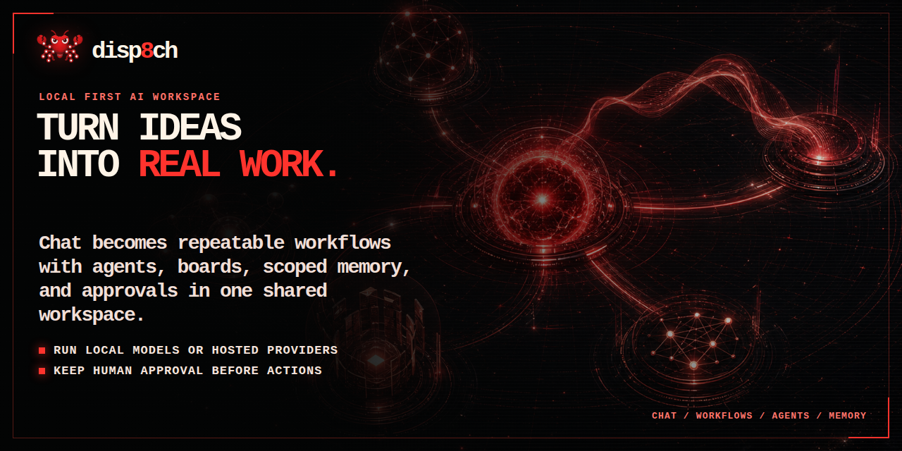
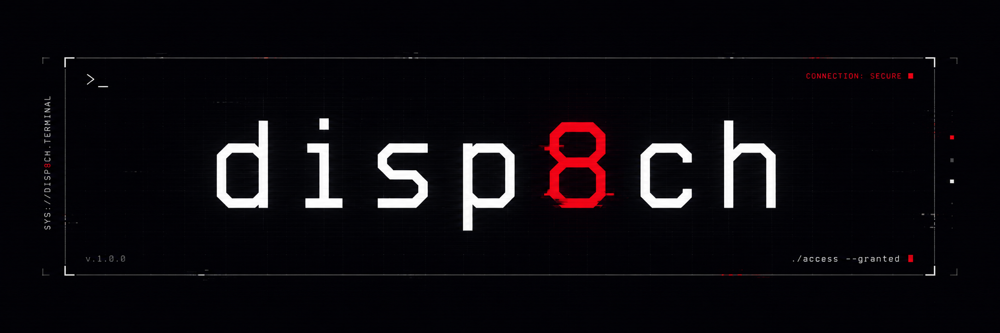
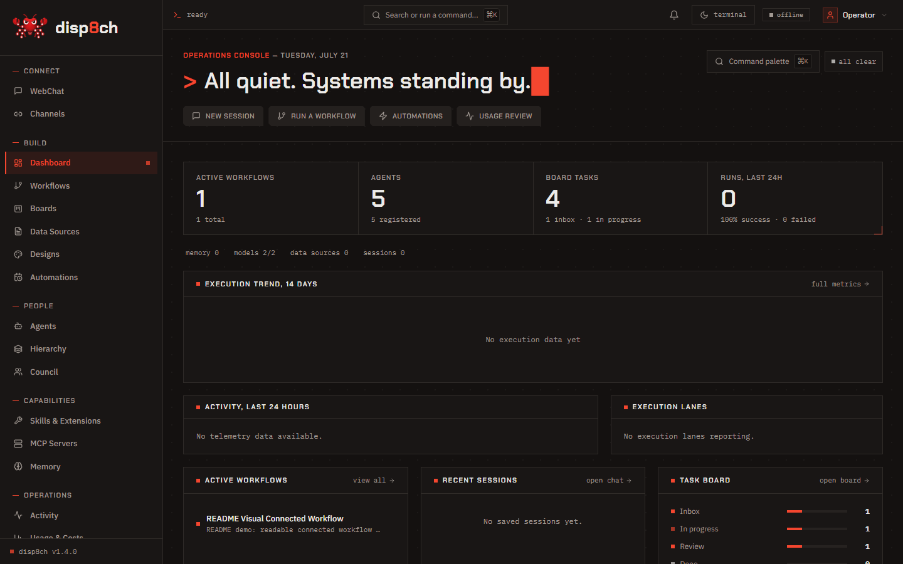
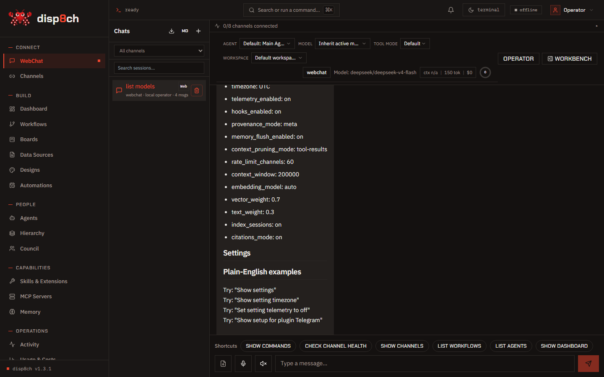
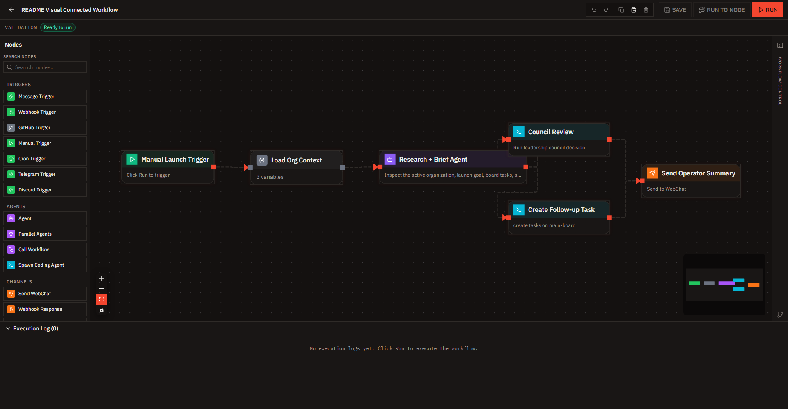
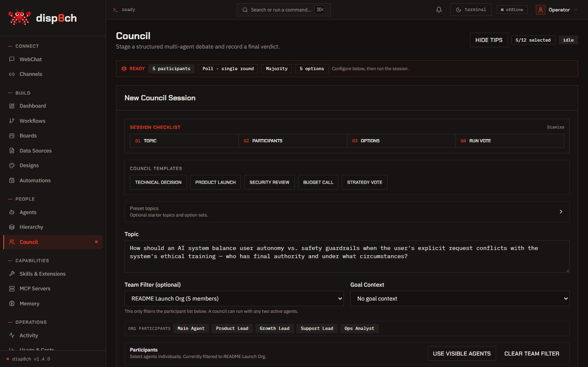
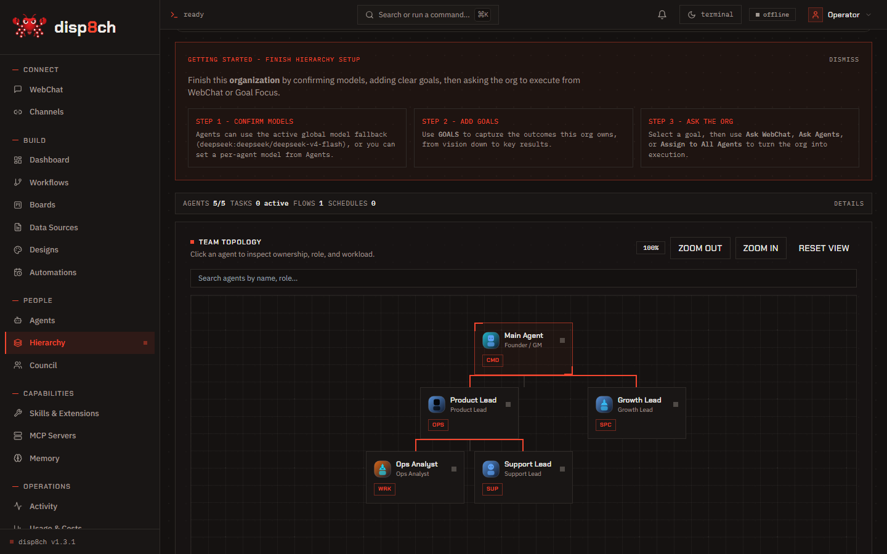
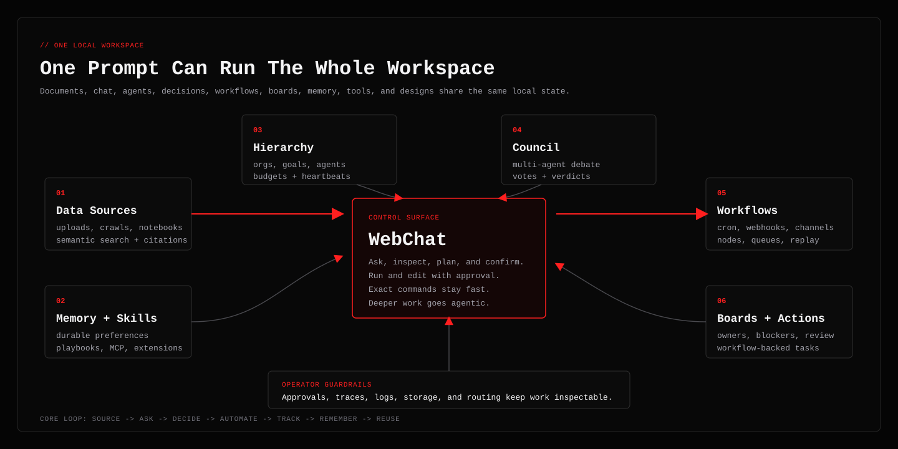
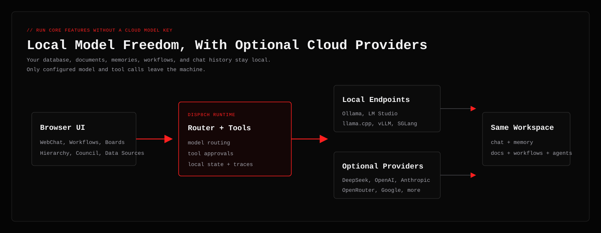

<p align="center">
  
</p>

<p align="center">
  
</p>

<p align="center">
  <a href="https://www.disp8ch.com/"></a>
  <a href="LICENSE"></a>
  <a href="https://nodejs.org/"></a>
  
  <a href="CONTRIBUTING.md"></a>
</p>

<h3 align="center">Chat in plain English. Get real workflows, real decisions, and shipped work.<br/>One app. Your machine. Your data.</h3>

<p align="center">
  <a href="https://www.disp8ch.com/">Website</a> ·
  <a href="#-install-in-30-seconds">Install</a> ·
  <a href="#-why-disp8ch">Why disp8ch</a> ·
  <a href="#-see-it">Screenshots</a> ·
  <a href="#-try-these-first">First Prompts</a> ·
  <a href="#run-fully-local-no-api-key">Run Fully Local</a> ·
  <a href="#core-features">All Features</a> ·
  <a href="#faq">FAQ</a>
</p>

---

Most AI tools give you a chat box. **disp8ch gives your chat box a company to run.**

Tell it *"build a daily 9 AM research digest and send it to my WebChat"* and it drafts a real, editable workflow on a visual canvas (triggers, nodes, schedules) and asks before saving. Put a question to a **Council** of agents and they debate, vote, and record a verdict with the dissent preserved. Give an agent **organization** goals and budgets and watch heartbeats, costs, and approvals in one dashboard. Everything runs self-hosted, works with **fully local models (no API key needed)**, and every side effect is **approval-gated and auditable**. No hidden prompt chains, no silent writes.

## ⚡ Install in 30 seconds

**Linux, macOS, or WSL**

```bash
curl -fsSL https://raw.githubusercontent.com/aaronnat23/disp8ch/main/scripts/install.sh | bash -s -- --repo https://github.com/aaronnat23/disp8ch.git
```

**Windows PowerShell**

```powershell
$env:DISP8CH_SOURCE_ZIP_URL = "https://github.com/aaronnat23/disp8ch/archive/refs/heads/main.zip"; iex (irm "https://raw.githubusercontent.com/aaronnat23/disp8ch/main/scripts/install-windows.ps1")
```

The installer sets up a managed Node runtime if needed, starts the app at `http://localhost:3100`, and opens onboarding. Connect a cloud key **or a local model** ([Ollama, llama.cpp, LM Studio, vLLM, SGLang](#run-fully-local-no-api-key)) and you're working. More options in [Quick Start](#quick-start).

## 🦞 Why disp8ch

- **🗣️ Plain English becomes real automation.** Describe a workflow; get an inspectable node graph you can edit, test, replay, and schedule, with 57 templates included. Not a black-box prompt chain.
- **🏛️ Decisions get a courtroom.** Council sessions make agents argue options, vote, and record a verdict, with the losing side's concerns kept on the record.
- **🏢 Agents get an org chart.** Roles, goals, reporting lines, budgets, heartbeats, and cost attribution: a company-style control plane, not 20 lost terminal tabs.
- **🧠 Memory you can actually read.** Scoped, reviewable memory files on disk with promotion queues and conflict flags. The agent learns; you stay in charge of what it keeps.
- **📚 Answers with receipts.** Upload files, crawl docs sites, build notebooks, and get cited answers, then turn them into tasks, workflows, or council debates in the same app.
- **🔌 Any model, including none of the cloud.** Direct providers, OpenRouter, or fully offline with local OpenAI-compatible runtimes. A built-in advisor recommends what fits your RAM/VRAM.
- **🔒 Nothing moves without your say-so.** Read-only agent runtime; every mutation goes through typed, confirmation-gated actions with an audit trail. Risky workflow effects require explicit grants.

## 📸 See It

<p align="center">
  
</p>

**Dashboard**: live system health, active workflows, agents, board tasks, and quick actions in one operator view.

<p align="center">
  
  
</p>

**WebChat** is the plain-English control surface for the whole workspace. **Workflows** is the visual canvas it builds on: trigger → org context → agent brief → council/board follow-up → output.

<p align="center">
  
</p>

**Council**: agents debate live on a court stage, vote, and the chamber records the verdict *and* the dissent.

<p align="center">
  
</p>

**Hierarchy**: the whole agent organization at a glance: roles, goals, reporting lines, heartbeats, budgets, and workload.

<p align="center">
  
</p>

**One operating loop**: a research brief can become a cited answer, then a Council decision, then a Hierarchy goal, then workflow-backed board tasks, then a saved design artifact, with one audit trail instead of five separate apps.

## 💬 Try These First

```text
What can this app currently do? Separate implemented, configured, and callable.
Build a daily 9 AM research digest workflow, but ask before saving if anything is ambiguous.
Start a council session on whether we should prioritize reliability or new features.
Spin up a research team, put them in an org, and give them a board task to compare OCR models.
Create a board task for each blocker in this launch document.
Remember that I prefer concise technical answers. Reply only saved.
```

More in [WebChat Examples](#webchat-examples), including repo audits, cited research briefs, and design generation.

> **⭐ If disp8ch looks useful, star the repo**. It is the best way to help other people find a local-first alternative. Found a rough edge? [Open an issue](https://github.com/aaronnat23/disp8ch/issues); bug reports are gifts.

---

## How The Tabs Work Together

disp8ch is built around one operating loop, not a pile of disconnected tools:

1. **Data Sources** ingests PDFs, documents, scraped pages, crawled docs sites, and connected-source snapshots into searchable context.
2. **WebChat** asks questions over that context, inspects app state, proposes plans, creates tasks, drafts workflows, and hands work to agents.
3. **Council** turns important decisions into structured debate with recorded options, votes, and verdicts.
4. **Hierarchy** assigns goals to organizations, roles, agents, budgets, reporting lines, heartbeats, and governance rules.
5. **Workflows** turns repeatable work into triggerable automations with cron, webhooks, RSS, channels, files, documents, memory, boards, agents, and response nodes.
6. **Boards** tracks the follow-up work created by WebChat, Council, Hierarchy, Data Sources, channels, or workflow outputs.
7. **Capabilities** keeps Memory, Skills & Extensions, and MCP Servers together without mixing their responsibilities. Hierarchy Ops can merge an approved skill/extension preset into an existing team, while MCP access is scoped separately per server.
8. **Operations** keeps Activity, Usage & Costs, and Maintenance visible; approvals, workflow-run detail, logs, and debug tools remain one click away under **More tools** when needed.
9. **Design Studio** saves generated artifacts into the same workspace, so a design can become a board task, workflow, source, or decision instead of a one-off image.

That means a research brief can become a cited WebChat answer, then a Council decision, then a Hierarchy goal, then workflow-backed board tasks, then a saved design artifact, with one audit trail instead of five separate apps.

## Core Features

### Agentic WebChat

- One plain-English control surface for the whole app: ask questions, inspect state, run research, and hand work to agents.
- Build and edit workflows from chat: create from a template, run, activate, or change a node's prompt, model, or config. Every change is a typed action you confirm first; nothing mutates until you approve.
- Real evidence, not vibes: tool-backed research, source and file grounding, post-answer verification, and honest handling of missing evidence.
- Depth on demand: rich answers by default, "keep it short" for compact ones, "thorough" for maximum depth.
- Risk-gated code edits with changed-file accounting and behavioral verification probes.

### Visual Workflow Automation

- Drag-and-drop canvas covering triggers (message, webhook, cron, manual, GitHub), agents, HTTP, RSS, files, documents, memory, logic, boards, and channels.
- 57 templates plus a recipe pack for common jobs: issue triage, PR review, uptime watch, news digests, scheduled reports, docs crawling, and more.
- Test as you build: node testing, run-to-node, replay, execution traces, versions, and retry from the failed node.
- Guardrails for unattended runs: per-workflow concurrency (skip duplicates or queue them durably), daily run/cost budgets with optional auto-disable, and escalation policies with quiet hours.
- Notify only on change: a node can emit `[SILENT]` and downstream sends stay quiet until something actually needs attention.
- Webhook workflows can answer the HTTP caller directly with a response node, and workflow JSON from other visual automation tools imports with unsupported nodes kept as visible placeholders.

### Dynamic Runs And Agent Harnesses

- `/loop <objective>` turns a long-running goal into a durable phase/worker run with pause, resume, cancel, and restart, visible in the Workflows tab.
- Saved run commands make useful autonomous jobs repeatable.
- Ready-made harnesses: a five-phase Project Manager workflow for repo work and a read-only Repo Audit pattern for quick health reports.

### Automations: Cron And Webhooks

- Guided scheduling turns plain choices (daily, weekly, interval, one-time) into validated cron jobs with run-now, resync, and enable/disable.
- Signed webhooks with HMAC verification, replay protection, rate limiting, and secret rotation.
- WebChat reads live automation state: "list my automations", "show webhook signing help", "design a daily digest job".

### Memory, Skills, And Self-Improvement

- Durable local memory with fast recall, retrieval explain, health view, and cleanup review. Startup profile files stay readable, editable markdown on disk.
- Instant deterministic saves: "remember this: key = value" and "what is ...?" answer in well under a second, no model round-trip.
- Skills install from bundled packs, folders, and git sources, with security scanning, provenance signals, and a verification harness before anything is trusted.
- Reviewable self-learning: after work, the agent proposes memory and skill improvements for your approval instead of silently rewriting your profile. Modes: Off, Review, and Auto with a promote threshold.

### Multi-Agent Operations

- Agents get per-agent models, tools, budgets, skills, and channel routing. Spawn parallel sub-agents (optionally in isolated git worktrees) that report back into the same session.
- Boards track the work: typed block reasons, escalation to human triage, recovery actions, and a "Needs human" filter.
- Hierarchy runs the org: multiple organizations, roles, reporting lines, goals with full ancestry, budgets, heartbeats, and workload in one map.
- Council records decisions: structured multi-agent debate, weighted votes, document context, and a final verdict with dissent preserved.
- Governance throughout: approval chains, budget warnings and hard-stops, config rollback, and an immutable audit trail with cost attribution.
- Every workflow side effect is classified from its real configuration just before it runs. Reads run automatically; external or irreversible actions require an approval bound to the exact payload, and unattended high-risk runs fail closed.
- One confirmed plan can create linked objects across Hierarchy, Council, Workflows, Boards, and Goals, recorded as a single inspectable work trail.
- Computer Use (beta, optional, off by default) adds approval-gated native desktop control through a Cua backend, separate from browser automation.

### Research, Notebooks, And Data Sources

- Multi-provider web search (Tavily, Brave, DuckDuckGo) with automatic fallback, plus browser automation for pages that need rendering.
- Upload PDF, DOCX, PPTX, TXT, Markdown, and HTML, import a local Markdown folder (e.g. an Obsidian vault), or scrape/crawl sites into searchable, citable sources with semantic search.
- Notebooks group sources with notes, generated outputs (mind maps, timelines, audio-overview scripts), chunk-level citations, and an in-place assistant for narrow source-bounded questions.
- WebChat stays the global surface: turn documents into tasks, goals, Council sessions, designs, or workflows.
- `/learn from document <id>` compiles source material into a reusable skill candidate, verified and left pending for your review. Learned skills are never auto-installed.
- **Hierarchy → Research Team** sets up an editable Scout → Analyst → Briefer team with workflows, schedules, and a local markdown knowledge vault in one guided flow.

### Design Studio

- Create and revise designs in place with a compact assistant that shares the WebChat session, model, tools, and history.
- Four-card intake: generate from a brief, import a screenshot/mockup, import HTML/source, or start from a template, with recipe packs and curated design systems.
- Select an element in the preview and edit its text, layout, spacing, typography, colors, and effects. One Apply creates one immutable version, and only changed properties are written.
- Artifacts persist with preview, validation, version history, and export instead of getting lost in a chat transcript.
- Design work stays connected to the same runtime, memory, Data Sources, Boards, Council, Hierarchy, and Workflows.

### Connect Anything: MCP, Extensions, And Tools

- Connect any MCP server from a dedicated page: catalog, per-tool enablement, approval policy, connection diagnostics, and named-agent access.
- Install extension packs for channels, providers, and integrations, enabled per agent.
- Define custom tools and expose any workflow as an agent tool.

### Voice

- Text-to-speech and speech-to-text via configurable providers (ElevenLabs, Whisper, and OpenAI-compatible endpoints), wired into workflows and channels.

### Desktop And Work Supervision

- Activity includes a live Work Monitor for agents, workflows, and background sub-agents, with watch windows for individual sessions.
- The Attention Center surfaces approvals, failed work, and actionable alerts in one place.
- `Ctrl/Cmd+K` opens the command palette; keyboard shortcuts are rebindable in Settings.

### Channels And Gateway

- Talk to your workspace from the channels you already use: WebChat is built in, plus Telegram, Discord, WhatsApp, Slack, Google Chat, Microsoft Teams, BlueBubbles/iMessage-style paths, and SMS delivery.
- Multi-agent routing maps different channels, accounts, or peers to isolated agents with their own workspaces and sessions.
- Inbound DMs are treated as untrusted: pairing/allowlists, command approvals, and optional per-session sandboxing.
- Run disp8ch on your own machine or a server and message it while it works; it is not tied to one laptop session.

#### Connect Telegram

1. In Telegram, open **BotFather**, run `/newbot`, and keep the returned token private.
2. In disp8ch, open **Channels → Telegram**, paste the token, and click **Connect**. The token is stored through the app's secret store, not in agent prompts.
3. Send the bot a message, then check the Telegram status card or **Channel Doctor** if it does not arrive.
4. Approve the pairing request or add the chat to the allowlist before granting tool or workspace access.

Discord and Slack follow the same token-and-status flow; WhatsApp uses its QR or configured business adapter. For headless installs, set `TELEGRAM_BOT_TOKEN` in `.env.local` and never commit that file.

### Model Freedom

Use one provider or many:

- Direct cloud APIs: OpenAI, Anthropic, Google, DeepSeek, Groq, Together, Mistral, xAI, Qwen/DashScope, Moonshot/Kimi, Zhipu, and other configured providers.
- OpenRouter for many hosted models behind one key.
- OpenAI-compatible local runtimes: Ollama, llama.cpp server, LM Studio, vLLM, SGLang, and similar endpoints.
- Per-agent model overrides and settings UI.

## What You Can Use It For

- **Personal chief-of-staff:** track goals, remember preferences, schedule recurring checks, summarize documents, and keep a live task board.
- **Research analyst:** compare products, collect current sources, separate confirmed facts from uncertainty, and produce cited briefs.
- **Local coding operator:** inspect repos, propose patches, edit files when asked, run verification, and explain changed files.
- **Workflow builder:** build webhook-to-LLM-to-channel flows, scheduled reports, triage workflows, and data-processing automations.
- **Local AI automation stack:** combine local models, local documents, workflow templates, webhooks, RSS, file operations, and vector search without a managed cloud account.
- **Notebook-to-action workspace:** upload source material, ask cited questions in WebChat, create board tasks, brief a Council, and turn the resulting decision into a workflow.
- **Agent team operator:** assign goals to agents, watch heartbeats, use budgets and approvals, coordinate parallel workers, and keep every task linked back to the organization goal.
- **Content studio:** turn research into outlines, drafts, social calendars, image/design briefs, and review queues.
- **Support desk:** route channel messages into boards, summarize tickets, trigger workflows, and escalate risky actions for approval.
- **Autonomous company dashboard:** create an organization, define goals, assign agents, monitor heartbeats, track costs, and review decisions.
- **Decision council:** ask several agents to debate a product, security, architecture, hiring, or budget question before you decide.
- **Design lab:** generate UI concepts, landing page drafts, product mockups, dashboards, diagrams, decks, and visual artifacts from chat.
- **Local model lab:** test cloud, OpenRouter, and local OpenAI-compatible model endpoints from the same app.

## Quick Start

### One-line install

The one-line installers are the easiest path for non-technical users. They download a managed Node.js 22 runtime if needed, use Corepack or `npx pnpm`, fetch the app source, install dependencies, create a clean local workspace, start disp8ch, and open onboarding.

### Linux, macOS, or WSL

```bash
curl -fsSL https://raw.githubusercontent.com/aaronnat23/disp8ch/main/scripts/install.sh | bash -s -- --repo https://github.com/aaronnat23/disp8ch.git
```

Add `--no-start` to install without starting the server.

Computer Use beta is **not installed by default**. Skip this unless you want the optional Cua desktop-control driver.
To install it during first setup:

```bash
curl -fsSL https://raw.githubusercontent.com/aaronnat23/disp8ch/main/scripts/install.sh | DISP8CH_WITH_COMPUTER_USE=1 bash -s -- --repo https://github.com/aaronnat23/disp8ch.git
```

You can also install disp8ch first and enable Computer Use later from **Settings -> Computer Use**.

### Windows PowerShell

```powershell
$env:DISP8CH_SOURCE_ZIP_URL = "https://github.com/aaronnat23/disp8ch/archive/refs/heads/main.zip"; iex (irm "https://raw.githubusercontent.com/aaronnat23/disp8ch/main/scripts/install-windows.ps1")
```

Pass `-NoStart` to the script to install without starting.

Computer Use beta is **not installed by default**. Skip this unless you want the optional Cua desktop-control driver.
To install it during first setup:

```powershell
$env:DISP8CH_WITH_COMPUTER_USE = "1"; $env:DISP8CH_SOURCE_ZIP_URL = "https://github.com/aaronnat23/disp8ch/archive/refs/heads/main.zip"; iex (irm "https://raw.githubusercontent.com/aaronnat23/disp8ch/main/scripts/install-windows.ps1")
```

This installs the optional Cua desktop-control driver, writes non-secret `DISP8CH_ENABLE_COMPUTER_USE=1` and `DISP8CH_CUA_DRIVER_CMD` values when the driver is found, and keeps readiness gated by **Settings → Computer Use → Run doctor**. If Cua install fails, disp8ch still installs and the settings page shows the remaining setup.

After install, onboarding opens at:

```text
http://localhost:3100/onboarding
```

### From a cloned checkout

If you already cloned the repo:

```bash
node install.js
```

Windows PowerShell from a cloned checkout:

```powershell
powershell -ExecutionPolicy Bypass -File .\install.ps1
```

### Manual developer path

Use this if you already have Node.js `22.13+` and want full control:

```bash
corepack enable
corepack pnpm install
corepack pnpm dpc init --ensure-env
corepack pnpm dev
```

Later runs from the installed app directory:

```bash
pnpm dev
```

Windows native install and local desktop packaging work, but public desktop installers are currently unsigned. macOS builds may show security warnings until Developer ID signing and notarization are added. Linux source install is the cleanest path today; native packages need release validation.

## First Model Setup

The easiest path is `/onboarding`. disp8ch supports four setup paths:

| Path | Use when | Credential model |
|---|---|---|
| **Online API key** | You want a hosted provider such as DeepSeek, OpenAI, Anthropic, Google, or OpenRouter. | Store a key as an environment variable or secret reference. |
| **Local AI** | You want private local inference through Ollama, LM Studio, llama.cpp, vLLM, SGLang, or another OpenAI-compatible server. | No provider key required. |
| **Claude account OAuth** | You already use Claude Code and want Anthropic models without managing a separate Anthropic API key. | Local Claude Code credentials or an OAuth token reference. |
| **Codex account sign-in** | You want optional coding-agent delegation through the installed Codex CLI. | Local Codex CLI session. Not the default WebChat model provider. |

For API key or local setup:

1. Choose **Online** and add an API key, or choose **Local**.
2. For Local, select **Check this PC** to inspect installed models, available RAM and VRAM, and detected runtimes.
3. Run the recommended Ollama or `llama-server` command, then select **Use this setup**.
4. Run validation, then open WebChat and send a message.

For Claude account OAuth:

1. Install and sign in to Claude Code on the same Windows user that runs disp8ch.
2. Keep the Claude Code credential file private. Do not copy `.claude`, OAuth token files, or auth JSON into the repo.
3. In disp8ch, select or add an Anthropic model in **Settings -> Models**.
4. If the model form asks for a credential, use an environment or secret reference such as `env:ANTHROPIC_TOKEN`, `env:ANTHROPIC_OAUTH_TOKEN`, `env:CLAUDE_CODE_OAUTH_TOKEN`, or `secret:CLAUDE_CODE_OAUTH_TOKEN`.
5. Run the model test before using the model in WebChat or workflows.

For Codex account sign-in:

1. Install the Codex CLI and sign in locally with your Codex account.
2. Keep Codex auth files outside the repo and outside `.env.local`.
3. Leave normal WebChat on your selected provider or local model. Codex sign-in is only used when you explicitly choose the Codex coding-agent backend for delegated coding work.
4. Test with a harmless read-only delegation before granting write access.

You can also configure `.env.local`:

```bash
cp .env.example .env.local
```

Direct provider examples:

```bash
OPENAI_API_KEY=...
ANTHROPIC_API_KEY=...
ANTHROPIC_TOKEN=...
ANTHROPIC_OAUTH_TOKEN=...
CLAUDE_CODE_OAUTH_TOKEN=...
GOOGLE_API_KEY=...
DEEPSEEK_API_KEY=...
```

OpenRouter:

```bash
OPENROUTER_API_KEY=...
```

Local model endpoints:

```bash
OLLAMA_BASE_URL=http://127.0.0.1:11434
VLLM_BASE_URL=http://127.0.0.1:8000/v1
SGLANG_BASE_URL=http://127.0.0.1:30000/v1
```

Do not commit `.env.local`, `.claude`, `.codex`, auth JSON, OAuth token files, or any local credential store.

## Run Fully Local (No API Key)

You do not need a cloud account or API key for core use. Run a local model server and point disp8ch at it: chat, local tools, memory, workflows, agents, boards, council, local document research, and local artifact work can run without a model-provider key. Live web search, external channels, cloud image generation, and third-party APIs still need network access and the credentials you choose to configure.

<p align="center">
  
</p>

### Pick A Model That Fits This PC

During onboarding, choose **Local** then select **Check this PC**. You can also open **Settings -> Models** later and
select **Check this PC** under **Find a local model for this PC**. The advisor reads the machine's RAM, CPU, GPU, and
VRAM and ranks local models by fit and expected speed. It parses installed GGUF metadata, detects exact Ollama tags,
uses `llama-fit-params` when available, and distinguishes full GPU, hybrid offload, CPU-heavy, and memory-risky plans.

#### The simple path for new users

1. Install and open disp8ch, then choose **Local AI** during onboarding.
2. Select **Check this PC**. The check is read-only and does not download a model or send your hardware details anywhere.
3. Review the three recommendations:

| Choice | Best for | What to expect |
|---|---|---|
| **Balanced** | Most users | The best starting point for useful answers without making the computer unnecessarily slow. |
| **Speed** | Older PCs, laptops, and quick chat | A smaller model that is more likely to fit fully in GPU memory and respond quickly. |
| **Quality** | Research, coding, and harder tasks | The strongest practical model found for the machine. It may use both GPU memory and system RAM, so it can be slower. |

The results show the detected CPU, RAM, GPU, free VRAM, installed local runtimes, and models already on the PC so the
recommendation is explainable. Start with **Balanced** when unsure. Select **Use this setup**, run the connection test,
and then open WebChat. If the model is not installed or running, disp8ch shows the exact Ollama or `llama-server`
command to run first.

Model priority controls routing. Complex chat turns and background learning use the highest-priority active model
configuration first, including that configuration's API key and base URL. Cost is only a tie-breaker inside the same
priority, so an optional local endpoint will not steal background work unless you deliberately make it primary.

**What disp8ch does not do:** it does not silently download models, start unknown executables, replace the active
model, or upload local model paths and hardware inventory. Recommendations remain suggestions until you explicitly
run the displayed command and save the setup.

The advisor is runtime-neutral:

- An existing GGUF file is paired with the detected `llama-server` and its exact file path.
- An installed Ollama model stays on Ollama.
- A download suggestion prefers an exact validated Ollama tag when one exists because it is the simplest install path.
- Nothing is downloaded, started, or activated automatically.

Choose **Test and review** after configuring a model. A successful connection test creates a non-blocking advisory.
Private or cloud model IDs remain valid even when they are absent from the public catalog; disp8ch does not claim that
a local model is more accurate without comparable evidence.

For installed models, **Benchmark on this PC** is optional and confirmation-gated. It runs a bounded streamed prompt,
records first-token and generation timing for the exact model/runtime/hardware/context combination, then uses that
measurement ahead of static estimates. Temporary llama.cpp servers bind only to `127.0.0.1`; Ollama models loaded by
the benchmark are unloaded afterward. Calibration never changes the active model.

The production model list is bundled with each disp8ch release. It contains manually verified model names, exact runtime
tags, expected size, architecture, context, and capability metadata. It never sends your hardware inventory, model
paths, or provider credentials anywhere. New model families are added in normal app updates after verification.

### Option A: Ollama (easiest)

1. Install [Ollama](https://ollama.com) and start it.
2. In onboarding, select **Check this PC** and use the exact `ollama run ...` command shown for the recommended model.
   Ollama downloads that model only after you run the command yourself:

```bash
ollama serve
ollama run <recommended-model-tag>
```

3. Open onboarding at `http://localhost:3100/onboarding`, choose **Local**, select **Check this PC**, run the shown command, then select **Use this setup**, test, and save. No key required.

Memory search works without choosing a separate provider. New installs default to disp8ch's built-in local embedding model (`Xenova/all-MiniLM-L6-v2`) and fall back to keyword search if the model cache is unavailable. If you prefer Ollama embeddings instead, run `ollama pull nomic-embed-text`, set **Settings -> Memory -> Embedding model** to `nomic-embed-text`, then click **Rebuild Index**.

Or via `.env.local`:

```bash
OLLAMA_BASE_URL=http://127.0.0.1:11434
```

### Option B: LM Studio, llama.cpp, vLLM, or SGLang (OpenAI-compatible)

1. Start your local server and load a model.
2. In onboarding choose the **LM Studio / OpenAI-compatible** preset and set the base URL. Leave the API key blank when the local server does not require one:

| Runtime | Base URL |
|---|---|
| LM Studio (Local Server) | `http://127.0.0.1:1234/v1` |
| llama.cpp (`--server`) | `http://127.0.0.1:8080/v1` |
| vLLM | `http://127.0.0.1:8000/v1` |
| SGLang | `http://127.0.0.1:30000/v1` |

3. Run the test and save.

Or via `.env.local`:

```bash
VLLM_BASE_URL=http://127.0.0.1:8000/v1
SGLANG_BASE_URL=http://127.0.0.1:30000/v1
```

**Tip:** do not choose from parameter count alone. Context size, quantization, architecture, current free RAM/VRAM,
and runtime support all affect whether a model is practical. Real AI image generation, live web search providers,
external channels, and third-party APIs still need their own credentials, but the core local workspace runs without a
model-provider key.

## WebChat Examples

```text
What can this app currently do? Separate implemented, configured, and callable.
List my automations and show which webhooks are enabled.
Create a webhook workflow that validates a GitHub-style JSON payload and summarizes it.
Compare three local model runtimes for an 8 GB VRAM laptop. Use current sources.
Audit this repo's API-key handling and cite exact files.
Create a board task for each blocker in this launch document.
Start a council session on whether we should prioritize reliability or new features.
Build a daily 9 AM research digest workflow, but ask before saving if anything is ambiguous.
Spin up a research team, put them in an org, and give them a board task to compare OCR models.
Generate a landing page concept for a local-first AI workspace and save it as a design.
Remember that I prefer concise technical answers. Reply only saved.
What is my preferred answer style?
```

## Migration And Imports

Have useful work in another local AI app? Bring the parts you want into disp8ch when a compatibility importer exists. disp8ch imports skill packs, compatible workflow JSON, and company/org templates from popular local agent ecosystems and converts them into safe, native disp8ch assets. **It never copies your secrets, databases, chat history, or auth state**.

### Bring Work From Another App

| Coming from | Command | What moves over |
|---|---|---|
| A `SKILL.md` skill library | `pnpm dpc skills install <folder-or-git-url>` or the matching compatibility importer listed by `pnpm dpc` | Skills become safe, normalized disp8ch skill packs (provenance kept; risky command/credential examples stripped). |
| A personal channel-assistant workspace | `pnpm dpc skills install <repo-path>` plus the matching compatibility importer if available | Skills imported as above, **plus** matching extension packs (channels, providers, memory backends) are detected and recommended. |
| An agent-company / org dashboard export | `pnpm dpc orgs import <company-pack.json>` or the matching compatibility importer listed by `pnpm dpc` | A company export/template becomes a local organization with agents, roles, goals, budgets, and governance context when the source format is supported. |
| Another disp8ch instance | `pnpm dpc orgs import ./company-pack.json` | A native org pack (export yours with `pnpm dpc orgs export <organization-id> ./company-pack.json`). |
| Another visual workflow automation tool | Workflows tab → Import, or the workflows API | Workflow JSON; unsupported nodes are preserved as visible placeholders with repair hints instead of being dropped. |

Generic and additional paths:

```bash
pnpm dpc skills install /path/to/skill-pack          # local skill pack folder
pnpm dpc skills install https://github.com/user/skills-repo.git   # git source
pnpm dpc skills list
pnpm dpc orgs list
pnpm dpc                                             # full command list for your installed version
```

Desktop builds can also import an existing disp8ch database (the importer backs up your current DB first).

Import rules:

- Secrets are never imported silently; add them later through Settings → Secrets.
- Runtime databases, chat history, uploaded private docs, and auth sessions are not imported and are not in public releases.
- Imported skills are scanned for high-signal security issues, stored as local skill packs, and disabled until you review them.
- Imported company packs create local organizations, goals, and agent roles you can review before activating.
- Review imported skills and company templates before enabling them for agents.

## Security And Control

disp8ch is local-first, but local-first does not mean careless. The app includes:

- admin-gated APIs;
- confirmation gates for risky app actions;
- webhook HMAC, replay, body-cap, and rate-limit controls;
- command approvals and sensitive-path blocking;
- optional shell sandboxing;
- credentials and secret storage paths;
- activity logs, approval records, run traces, and cost attribution;
- backups, checkpoints, rollback-oriented workflows, and desktop data import backups.

You still control your deployment. Be careful with exposed ports, channel bot tokens, API keys, and any workflow that can write files, send messages, call paid APIs, or execute shell commands.

## Useful CLI Commands

```bash
pnpm dpc status
pnpm dpc health
pnpm dpc doctor
pnpm dpc models list
pnpm dpc workflows list
pnpm dpc boards list
pnpm dpc orgs list
pnpm dpc skills list
pnpm dpc backup status
pnpm dpc learning status
pnpm dpc goals list
```

Developer checks:

```bash
pnpm install
pnpm exec tsc --noEmit
pnpm build
```

Desktop checks:

```bash
pnpm desktop:build
```

The maintainer release suite is run from the private development workspace before public exports. The public repository intentionally excludes generated runtime state and private release artifacts.

## Repository Layout

- `src/`: Next.js app, API routes, UI, channel router, agents, workflows, memory, governance, and design surfaces.
- `server/`: websocket server.
- `desktop/`: desktop shell and packaging logic.
- `extensions/`: bundled extension packs.
- `skills/`: bundled skill packs.
- `optional-skills/`: optional local skill packs.
- `scripts/`: setup, CLI, export, verification, and packaging entrypoints.
- `docs/`: public README assets included in the clean release.
- `data/`: local runtime state created on first run.

## FAQ

**Do I need an API key or a cloud account?**
No for core use. Run fully local with Ollama, LM Studio, llama.cpp, vLLM, or SGLang; see [Run Fully Local](#run-fully-local-no-api-key). Cloud providers, web search, channels, and image generation only need the credentials you choose to configure.

**How is this different from a chatbot or a terminal assistant?**
Those are one capability. disp8ch is the workspace around them: workflows, schedules, multi-agent operations, a decision council, memory, research, and design, all driven from plain-English chat.

**Data Sources, Notebooks, or `/learn`?**
Data Sources for searchable files and cited answers. Notebooks to group related sources with a narrow boundary. `/learn` when the material should become a reusable skill; candidates stay pending until you approve them.

**Can I run more than one organization?**
Yes. One deployment hosts multiple organizations with their own agents, goals, budgets, and governance.

**Can I bring work from the app I already use?**
Yes. Import compatible skills, workflow JSON, and org templates. See [Migration and Imports](#migration-and-imports).

**Does it work unattended?**
Yes. Cron, signed webhooks, heartbeats, and standing goals keep work moving; risky actions stay confirmation-gated.

**Is my data private?**
Local-first. Your database, memories, documents, and chat history stay on your machine; only the model, tool, and channel calls you configure leave it.

**Can I reach it from my phone?**
Yes. Run it on a machine or server and talk to it from WebChat, Telegram, Discord, Slack, WhatsApp, and more.

## Honest Boundaries

- This is a local-first self-hosted app, not a managed cloud service.
- Some channels and providers require third-party accounts or API keys; chat and core features run fully local with no key (see [Run Fully Local](#run-fully-local-no-api-key)).
- Optional capabilities depend on configuration: voice (TTS/STT) and web search/browser tools use providers you set up, and MCP/extension tools depend on the servers and packs you connect.
- Real AI image generation requires configured image-provider credentials; local browser fallback can create simple artifacts when no provider is configured.
- Public desktop installers are not yet signed/notarized.
- Long-horizon autonomous behavior works through goals, daemon processing, boards, and heartbeats, but real multi-day reliability depends on your model, tools, budgets, and deployment.
- The app is designed to be agentic for non-trivial work, but it intentionally keeps exact commands and protected reads fast and deterministic.

## License

Released under the [MIT License](LICENSE).
